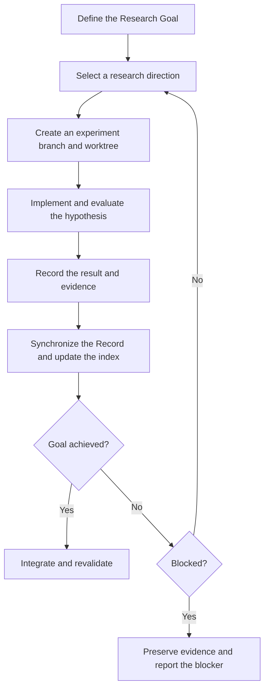

# Auto Research Skill

`auto-research` is a Codex skill for organizing open-ended research as a sequence of **traceable and reproducible experiments**.

It gives Codex a practical framework for setting research goals, testing ideas, keeping track of evidence, and building on what each experiment reveals. The cycle continues until the evidence supports the goal or a predefined stopping condition is met.

## When it is useful

The skill is well suited to work that may require several rounds of evidence-driven experimentation, including:

- improving the performance of a model, algorithm, or system;
- comparing alternative implementations;
- running parameter searches or ablation studies;
- reproducing results and evaluating possible improvements;
- investigating engineering or research questions that may not have an immediate answer.

For small one-off changes or questions that do not need experimental validation, a simpler workflow may be more appropriate.

## Core concepts

### Research Goal

`goal.md` describes the research objective, Acceptance Criteria, constraints, authorized boundaries, and Blocked Stop Conditions. It serves as the working contract for the research and is generally kept stable while experiments are in progress.

### Experiment Record

Each self-contained experiment is captured as an **Experiment Record**, or **Record**. A Record includes its hypothesis, provenance, implementation, result, conclusion, and supporting evidence.

Record IDs begin with `001` and increase across the research effort. Existing or reserved IDs are not reused.

### Research directions and iterations

- A **New Research Direction** starts from the current `goal/main` state and uses `parents: []`.
- An **Iterative Experiment** builds on findings from one or more earlier Records and selects one Parent Record as its Git implementation base.

Parent Record edges describe how the research evolved, while Git ancestry identifies the implementation state used by an experiment. These relationships are related but do not need to be identical.

## Workflow



A typical experiment follows these steps:

1. Read `goal.md`, `records.yaml`, and relevant prior Records from `goal/main`.
2. Choose a new direction or an iteration based on earlier findings.
3. Create a `feat/record-<record-id>-<branch-slug>` branch and a temporary `worktrees-<record-id>` worktree.
4. Implement the hypothesis, run the experiment, and retain useful evidence.
5. Commit runnable code separately from research metadata.
6. Close the Record, synchronize it to `goal/main`, and update `records.yaml`.
7. Remove the temporary worktree after its contents have been checked and preserved.
8. Continue with another experiment when the goal is not yet supported and no stop condition applies.
9. When the goal appears to be achieved, integrate the relevant code and rerun the Acceptance Criteria on `goal/main`.

See [`references/workflow.md`](references/workflow.md) for the full lifecycle and its operational requirements.

## Repository layout

An initialized research repository uses the following structure alongside its existing code:

```text
<repository>/
|-- goal.md
|-- records.yaml
|-- records/
|   `-- <record-id>/
|       |-- record.md
|       |-- result.md
|       `-- artifacts/
`-- worktrees-<record-id>/
```

- `goal.md` contains the Research Goal and Acceptance Criteria.
- `records.yaml` indexes finalized Records.
- `record.md` describes the experiment and its reasoning.
- `result.md` summarizes verification, reproduction, analysis, and conclusions.
- `artifacts/` stores supporting logs, metrics, snapshots, or plots.
- `worktrees-<record-id>/` is the temporary Git worktree for an active experiment.

## Git model

The skill uses Git to preserve the state and provenance of the research:

- `goal/main` holds the Research Goal, Experiment Index, and synchronized Records.
- Experiments run on separate `feat/record-<record-id>-<branch-slug>` branches.
- Code and research metadata are committed separately.
- A Record is closed with a terminal Record Commit containing its Record directory.
- Experiment branches are retained after their temporary worktrees are removed.

The detailed commit boundaries and synchronization rules are documented in [`SKILL.md`](SKILL.md) and [`references/workflow.md`](references/workflow.md).

## Outcomes

Experiment execution and Research Goal attainment are tracked separately:

| Field | Meaning |
| --- | --- |
| `COMPLETED` | The experiment finished with a valid, interpretable result, including a negative or non-improving result. |
| `FAILED` | The experiment could not be completed because a required condition, resource, or capability was unavailable. |
| `Research Goal achieved: YES` | The experiment is complete and the retained evidence supports the applicable Acceptance Criteria. |
| `Research Goal achieved: NO` | One or more criteria remain unmet or do not yet have sufficient evidence. |

A failed experiment does not necessarily end the overall research effort. The process stops when the cause also meets a Blocked Stop Condition defined in `goal.md`.

## Installation

Place or clone this directory under the Codex skills directory, for example:

```text
~/.codex/skills/auto-research/
```

Keep `SKILL.md` and the `references/` directory together, then reload Codex so it can discover the skill.

## Usage

Invoke `$auto-research` from a Git repository and describe the objective, verification method, and relevant constraints:

```text
Use $auto-research to improve inference throughput in the current project.

Objective: Improve benchmark throughput by at least 20% without reducing output quality.
Verification: Run scripts/benchmark.ps1 five times with a fixed dataset and random seed, then compare the median with the baseline.
Constraints: Keep the current model and test coverage. Limit the change scope to src/ and config/.
Stop conditions: The required GPU is unavailable, or one experiment is expected to exceed two hours.
```

Useful inputs include a measurable objective, an executable verification procedure, a baseline and threshold, resource limits, permitted paths, and practical stop conditions. If an important detail is missing, Codex may ask for clarification while preparing `goal.md`.

## Reference files

| File | Purpose |
| --- | --- |
| [`SKILL.md`](SKILL.md) | Skill entry point and core operating rules. |
| [`references/workflow.md`](references/workflow.md) | Experiment lifecycle and Git transitions. |
| [`references/goal.md`](references/goal.md) | Research Goal template. |
| [`references/record.md`](references/record.md) | Experiment Record template. |
| [`references/result.md`](references/result.md) | Experiment result template. |
| [`references/records.yaml`](references/records.yaml) | Experiment Index template. |

## Safety and reproducibility

The workflow is designed to preserve unrelated user work, keep code separate from research metadata, retain useful reproduction evidence, and avoid storing secrets in Records or artifacts. Worktrees are checked before removal, and accepted changes are revalidated after integration.

For exact requirements and edge cases, refer to [`SKILL.md`](SKILL.md) and [`references/workflow.md`](references/workflow.md).

## License

This repository does not currently include a license. Consider adding one before publishing or redistributing the project.
